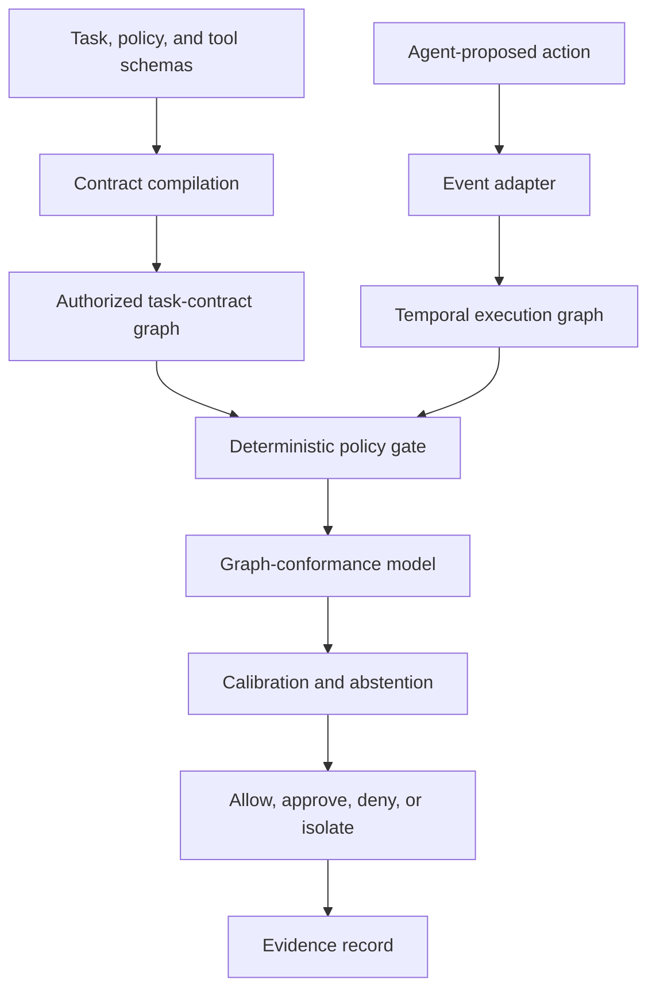

# SentryGraph

**Contract-to-execution graph conformance for tool-using AI agents**

SentryGraph is a research prototype for governing tool-using AI agents before an external or persistent effect occurs. It compiles an authorized task into a task-contract graph, records proposed and completed actions in a temporal execution graph, and combines deterministic policy enforcement with learned graph-conformance assessment.

The project is designed to study a central agent-security question: **does the proposed action remain within the authority granted by the user's task, even when the action sequence appears locally valid?**

> **Research status:** active prototype. SentryGraph is not a production security boundary and should not be used as the sole control for high-impact deployments.

## System overview



SentryGraph evaluates both explicit policy constraints and execution-graph conformance. Its evidence records preserve the contract, principal, tool, arguments, decision, graph relations, and outcome needed for later audit.

## Main capabilities

- Task-conditioned contract compilation with tool- and argument-level constraints.
- Pre-execution interception of proposed tool actions.
- Fail-closed handling of prohibited tools, invalid arguments, unsupported write tasks, and inactive principals.
- Temporal execution graphs linking proposals, tools, targets, contracts, decisions, and outcomes.
- Multi-agent delegation with authority attenuation, bounded depth, revocation, and principal attribution.
- AgentDojo integration for single-agent and multi-agent security experiments.
- Leakage-resistant graph-prefix labeling and feature construction.
- Classical and relational graph-conformance baselines.
- Calibration, abstention, and hybrid deterministic/learned policy export.
- Reproducible experiment planning with frozen plan identities and matched control conditions.

## Repository structure

```text
SentryGraph/
├── sentrygraph/                         # Core library
│   ├── contract_compiler.py             # Task-contract construction
│   ├── policy_gate.py                   # Deterministic action enforcement
│   ├── execution_graph.py               # Single-agent execution graphs
│   ├── multi_agent_contracts.py         # Delegated authority and attenuation
│   ├── multi_agent_execution_graph.py   # Multi-agent graph construction
│   ├── multi_agent_runtime.py           # Multi-agent enforcement runtime
│   ├── agentdojo_adapter.py             # AgentDojo interception adapter
│   ├── prefix_labeler.py                # Independent prefix labels
│   ├── graph_features.py                # Graph-derived features
│   ├── relational_graph_data.py         # Relational graph tensors
│   └── hybrid_conformance_policy.py     # Hybrid policy runtime
├── scripts/                             # Planning, execution, analysis, and validation
├── outputs/                             # Generated artifacts; ignored by Git
├── pyproject.toml                       # Package and dependency metadata
└── README.md
```

## Requirements

- Python 3.11 or newer
- AgentDojo 0.1.35
- Optional learning stack: NumPy, scikit-learn, and PyTorch
- macOS or Linux is recommended for the documented workflow

The relational model supports deterministic CPU execution and optional Apple Metal Performance Shaders (`mps`).

## Installation

Clone the repository and create an isolated environment:

```bash
git clone https://github.com/mbonimpaye-hub/SentryGraph.git
cd SentryGraph
python3 -m venv .venv
source .venv/bin/activate
python -m pip install --upgrade pip
python -m pip install -e '.[learning]'
python -m pip install pytest
```

Confirm that the package and primary dependencies import correctly:

```bash
python - <<'PY'
import agentdojo
import numpy
import sklearn
import sentrygraph
import torch

print("AgentDojo:", getattr(agentdojo, "__version__", "installed"))
print("NumPy:", numpy.__version__)
print("scikit-learn:", sklearn.__version__)
print("PyTorch:", torch.__version__)
print("SentryGraph:", sentrygraph.__file__)
PY
```

## Quick validation

Pytest currently discovers one conventional unit test:

```bash
python -m pytest scripts -q
```

The repository also uses standalone validation programs. The parameter-free validation set can be run with:

```bash
for script in \
  scripts/test_agentdojo_contract_factory.py \
  scripts/test_agentdojo_write_contracts.py \
  scripts/test_contract_compiler.py \
  scripts/test_contract_enforcement.py \
  scripts/test_execution_graph.py \
  scripts/test_graph_features.py \
  scripts/test_interception.py \
  scripts/test_invariant_graph_features.py \
  scripts/test_model_driven_multi_agent_runtime.py \
  scripts/test_multi_agent_agentdojo_runtime.py \
  scripts/test_multi_agent_contracts.py \
  scripts/test_multi_agent_execution_graph.py \
  scripts/test_multi_agent_runtime.py \
  scripts/test_multi_agent_security_plan.py \
  scripts/test_policy_denial.py \
  scripts/test_prefix_labeler.py \
  scripts/test_relational_graph_data.py \
  scripts/test_runtime_graph_integration.py
do
  python "$script" || break
done
```

At the audited revision, all 18 parameter-free validation programs passed. Six additional validators require artifacts generated by their corresponding experiment stages and therefore are not included in the parameter-free loop.

## Safety defaults for experiment execution

Experiment runners separate inspection from execution:

- Omitting `--execute` performs plan inspection without executing trajectories.
- `--max-executions 0` means no new paid trajectories.
- Supplying `--execute` may invoke configured model APIs and incur cost.
- Generated results are written below `outputs/`, which is intentionally excluded from version control.

Inspect a frozen plan without paid execution:

```bash
python scripts/run_single_agent_experiments.py \
  --plan <PLAN.json> \
  --phase benign \
  --max-executions 0
```

## Experimental workflow

The repository contains several experiment generations. Use the frozen plan and output paths associated with the study being reproduced. Angle-bracketed values below are explicit user-supplied paths.

### 1. Inspect the AgentDojo installation

```bash
python scripts/audit_agentdojo.py
```

### 2. Plan and execute experiments

Planning scripts include:

- `plan_single_agent_experiments.py`
- `plan_multi_agent_security_experiments.py`
- `plan_model_driven_multi_agent_experiments.py`
- `plan_expanded_model_driven_multi_agent_experiments.py`

Inspect the selected planner before use:

```bash
python scripts/plan_single_agent_experiments.py --help
```

Single-agent benign execution:

```bash
python scripts/run_single_agent_experiments.py \
  --plan <PLAN.json> \
  --phase benign \
  --output-root outputs \
  --max-executions <N> \
  --execute
```

Frozen multi-agent security execution:

```bash
python scripts/run_multi_agent_security_experiments.py \
  --plan <PLAN.json> \
  --output-root outputs \
  --max-executions <N> \
  --execute
```

Model-driven multi-agent execution requires an exported hybrid policy bundle:

```bash
python scripts/run_model_driven_multi_agent_benign.py \
  --plan <PLAN.json> \
  --hybrid-policy-bundle <POLICY_BUNDLE> \
  --output-root outputs \
  --max-executions <N> \
  --execute

python scripts/run_model_driven_multi_agent_attacks.py \
  --plan <PLAN.json> \
  --hybrid-policy-bundle <POLICY_BUNDLE> \
  --output-root outputs \
  --max-executions <N> \
  --execute
```

### 3. Build graph-prefix examples

```bash
python scripts/build_graph_conformance_dataset.py \
  --experiment-roots <EXPERIMENT_ROOT_1> <EXPERIMENT_ROOT_2> \
  --output-dir <DATASET_ROOT> \
  --seed 42
```

The independent prefix labeler derives conformance labels without reading model predictions. Graph prefixes are constructed to exclude future events and policy outcomes unavailable at decision time.

### 4. Encode graph features

```bash
python scripts/encode_graph_conformance_features.py \
  --dataset-root <DATASET_ROOT> \
  --output-dir <FEATURES_ROOT>
```

### 5. Train classical baselines

```bash
python scripts/train_graph_conformance_baselines.py \
  --features-root <FEATURES_ROOT> \
  --output-dir <BASELINES_ROOT> \
  --seeds <SEED_LIST>
```

For task-held-out evaluation:

```bash
python scripts/train_task_heldout_conformance_baselines.py \
  --features-root <GENERALIZATION_FEATURES_ROOT> \
  --output-dir <TASK_HELDOUT_BASELINES_ROOT> \
  --seeds <SEED_LIST>
```

### 6. Train relational graph models

```bash
python scripts/train_relational_graph_conformance.py \
  --graphs-root <GRAPHS_ROOT> \
  --output-dir <RELATIONAL_RESULTS_ROOT> \
  --seeds <SEED_LIST> \
  --epochs <EPOCHS> \
  --patience <PATIENCE> \
  --batch-size <BATCH_SIZE> \
  --device cpu
```

Use `--device cpu` for deterministic execution. `--device mps` may accelerate training on supported Apple hardware but can introduce backend-dependent variation.

### 7. Calibrate and export the hybrid policy

```bash
python scripts/calibrate_abstain_conformance_models.py \
  --baselines-root <TASK_HELDOUT_BASELINES_ROOT> \
  --output-dir <CALIBRATION_ROOT> \
  --risk-budget <RISK_BUDGET> \
  --isolation-quantile <QUANTILE> \
  --ece-bins <BINS>

python scripts/export_hybrid_conformance_policy.py \
  --features-root <GENERALIZATION_FEATURES_ROOT> \
  --baselines-root <TASK_HELDOUT_BASELINES_ROOT> \
  --calibration-root <CALIBRATION_ROOT> \
  --fold <FOLD> \
  --view <VIEW> \
  --model <MODEL> \
  --output-dir <POLICY_BUNDLE>
```

## Artifact-dependent validation

The following validators require previously generated plans, feature sets, ablations, qualifications, or policy bundles:

```text
test_direct_invariant_ablation.py
test_expanded_model_driven_plan.py
test_hybrid_conformance_policy.py
test_model_driven_multi_agent_attack_qualification.py
test_model_driven_multi_agent_plan.py
test_structure_provenance_ablation.py
```

Run each validator only after producing its required upstream artifacts. Use `--help` to inspect the required paths, for example:

```bash
python scripts/test_hybrid_conformance_policy.py --help
```

## Reproducibility notes

- Keep frozen plan JSON files with the results they generated.
- Record the Git commit, Python version, dependency versions, device, seeds, and model/API configuration.
- Do not fit vocabularies, calibration maps, thresholds, or preprocessing transformations on held-out tasks.
- Preserve matched baseline/SentryGraph cells when comparing security and utility.
- Retain evidence JSONL files and execution graphs for decision-level audit.
- Do not commit `outputs/`, virtual environments, credentials, model-provider secrets, or generated archives.

## Limitations

SentryGraph is an experimental research implementation. Current limitations include dependence on the completeness of compiled contracts and tool schemas, benchmark-specific adapters, incomplete pytest-style coverage, possible distribution shift in learned conformance models, and reliance on explicit abstention or isolation when confidence is insufficient. Passing the included validation programs does not establish production security.

## Responsible use

Use this repository only with systems, accounts, data, and model APIs that you are authorized to test. Begin with plan inspection and small execution limits. Review evidence records before enabling actions with external, destructive, financial, privacy-sensitive, or persistent consequences.

## Citation

A formal citation will be added when the accompanying SentryGraph manuscript is publicly available. Until then, cite the repository URL and the exact Git commit used in your experiments.

## License

No license file is currently included. Unless and until a license is added, the repository should not be treated as granting permission to copy, modify, or redistribute the software.

## Contact

Please use the repository's issue tracker for reproducibility questions, bug reports, and requests concerning research artifacts.
